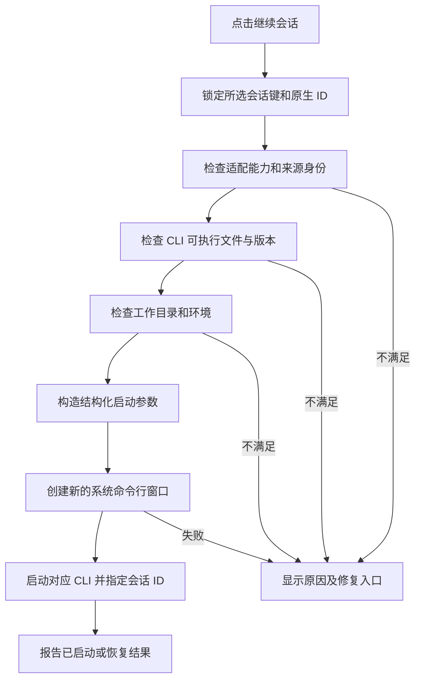

# CLI 会话管理面板需求文档

| 项目       | 内容                                                                          |
| ---------- | ----------------------------------------------------------------------------- |
| 所属软件   | Zed 社区增强版，当前 Zed-Dev 仓库                                             |
| 功能名称   | CLI 会话管理 / CLI Sessions                                                   |
| 文档版本   | v1.0，需求评审稿                                                              |
| 编写日期   | 2026-10-17                                                                    |
| 适用读者   | 产品、交互设计、Rust / GPUI 开发、测试人员                                    |
| 交付范围   | 目标需求、交互规则、适配约束、分阶段验收标准                                  |
| 已确认工具 | Codex CLI、Claude Code、Grok Build                                            |
| 暂定工具   | Antigravity 按 Google 官方 Antigravity CLI（`agy`）设计，具体安装版本仍需验证 |

> 本文定义完整目标规格。当前代码交付状态见第 24 节；文中的“必须”为最终验收约束，“建议”为可调整设计。CLI 的命令、数据位置依据只读帮助和官方资料核实，内部文件结构仍需通过脱敏样本验证。

## 1. 产品目标与核心约定

新增一个独立面板，集中发现、管理、搜索和浏览不同 AI CLI 的历史会话。用户找到目标会话后，点击“继续会话”，软件创建一个新的系统命令行窗口，在正确的项目目录启动对应 CLI，并恢复该条会话。

核心约定如下：

1. **管理范围覆盖软件外创建的会话。** 只要会话位于已启用的数据源中，就应被发现；不限于从 Zed 启动的会话。
2. **查看与继续分别操作。** 单击列表项打开只读详情；“继续会话”按钮和对应快捷操作才启动 CLI。
3. **继续的是所选会话。** 使用原生会话 ID，不以“最近会话”、标题匹配或重新发送摘要替代。
4. **每次有效的继续操作创建一个新系统命令行窗口。** 默认不复用现有窗口、终端标签页或 Zed 内置终端。
5. **恢复对话上下文，不自动恢复代码文件。** 不自动切分支、检出快照、回滚代码或创建 worktree。
6. **能力按证据展示。** 列表、正文、搜索、恢复可以分别可用；缺失能力必须说明原因。
7. **四个目标工具均属于完整目标。** 可以分阶段交付，但不能用三个工具可用宣称四工具需求已完成。

成功场景：用户记得“上周用 Grok 讨论过登录问题”，打开面板，筛选 Grok Build 和最近 7 天，搜索“登录”，检查命中消息，点击继续；随后出现新的系统命令行窗口，Grok 在原项目目录恢复同一个会话，用户可直接输入后续问题。

## 2. 背景、现状与适配边界

### 2.1 当前项目已有基础

根据当前仓库代码，已有能力及其对本需求的影响如下。

| 已有基础                                                 | 代码或文档依据                                                                                      | 本功能的处理方式                                |
| -------------------------------------------------------- | --------------------------------------------------------------------------------------------------- | ----------------------------------------------- |
| 默认外部智能体包含 Claude、Codex、Grok Build、Gemini     | [默认配置](../../../assets/settings/initial_user_settings.json)                                     | 复用名称与图标，不把 ACP 配置视为原生历史库     |
| Agent Panel 已处理外部智能体和历史线程                   | [agent_panel.rs](../../../crates/agent_ui/src/agent_panel.rs)                                       | 可增加跳转入口；新面板有独立的跨工具检索职责    |
| 终端线程记录标题、创建时间、项目路径、远程连接和工作目录 | [terminal_thread_metadata_store.rs](../../../crates/agent_ui/src/terminal_thread_metadata_store.rs) | 可辅助关联来源，不替代 CLI 自己的会话 ID 和正文 |
| Terminal Threads 将 CLI 自身的认证、配置交给 CLI         | [Terminal Threads](../../src/ai/terminal-threads.md)                                                | 继续沿用 CLI 自身的认证、模型和工具配置         |
| Dock 已支持左侧、右侧及左右悬浮位置                      | [dock.rs](../../../crates/workspace/src/dock.rs)                                                    | 新面板应接入现有面板框架和位置持久化机制        |
| 现有打开终端操作创建 Zed 内部终端                        | [terminal_panel.rs](../../../crates/terminal_view/src/terminal_panel.rs)                            | 系统新窗口启动需要单独实现平台启动能力          |

上述代码只证明已有集成基础，不能证明 ACP 会话、Zed 线程 ID 与原生 CLI 会话 ID 可互换。关联关系必须由适配器明确提供。

### 2.2 工具身份及已核实恢复命令

以下命令表示 CLI 参数语义，不是可直接拼接执行的 shell 模板；工作目录和环境由启动器独立设置。

| 工具                   | 稳定工具标识建议 | 指定会话恢复方式                       | 核实情况                                                  |
| ---------------------- | ---------------- | -------------------------------------- | --------------------------------------------------------- |
| OpenAI Codex CLI       | `codex`          | `codex resume <session_id>`            | 本机 `codex-cli 0.163.0` 帮助及官方文档支持               |
| Anthropic Claude Code  | `claude_code`    | `claude --resume <session_id>`         | 本机 `2.1.237` 帮助及官方文档支持                         |
| xAI Grok Build CLI     | `grok_build`     | `grok --resume <session_id>`           | 用户已确认工具身份；本机 `grok 1.0.62` 帮助及官方文档支持 |
| Google Antigravity CLI | `antigravity`    | `agy --conversation <conversation_id>` | 官方文档支持；本次未发现可供验证的本机 `agy` 命令         |

命令依据：[Codex 命令参考](https://learn.chatgpt.com/docs/developer-commands?surface=cli)、[Claude Code CLI 参考](https://code.claude.com/docs/en/cli-reference)、[Grok Build Sessions](https://docs.x.ai/build/features/sessions)、[Antigravity Resume](https://www.antigravity.google/docs/cli/commands/resume)。

必须区分 Grok Build 与第三方同名 `grok-cli`。已有 `grok-build` ACP 注册项可作展示关联，但实际恢复仍调用所选 Grok Build 可执行文件。

### 2.3 数据来源的事实与未知项

| 工具        | 已有依据                                                                            | 仍需开发验证的内容                                                         |
| ----------- | ----------------------------------------------------------------------------------- | -------------------------------------------------------------------------- |
| Codex       | 会话文本位于 `$CODEX_HOME/sessions`，默认 `~/.codex/sessions`；官方另列归档目录     | 各版本元数据、会话分支、归档后的恢复约束、可用的结构化读取接口             |
| Claude Code | 默认 JSONL 位于 `~/.claude/projects/<project>/<session-id>.jsonl`；可改变配置根目录 | 脚本接口的可用版本、消息链重建、子代理区分、清理与保留配置                 |
| Grok Build  | 会话保存在 `~/.grok/sessions/`，按工作目录关联；有 list/search/export 命令          | 本机版本的结构化枚举能力、全项目覆盖、分页、事件格式、读取是否启动后台服务 |
| Antigravity | 文档给出最近会话缓存 `~/.gemini/antigravity-cli/cache/last_conversations.json`      | 完整枚举、全部正文、离线数据和受支持接口；不能把最近缓存当作完整历史       |

来源：[Codex 状态文件位置](https://learn.chatgpt.com/docs/reference/troubleshooting)、[Codex 环境变量](https://learn.chatgpt.com/docs/config-file/environment-variables)、[Claude Code 会话管理](https://code.claude.com/docs/en/sessions)、[Grok Build Sessions](https://docs.x.ai/build/features/sessions)、[Antigravity Resume](https://www.antigravity.google/docs/cli/commands/resume)。

Claude Code 官方说明 JSONL 内部结构会变化，优先使用受支持的脚本接口或导出能力；需要文件解析时按已验证版本兼容。Antigravity 的缓存只维护每个项目的最近会话 ID，完整会话可能依赖服务端，必须单独验证。不能据此承诺四个工具全部离线读取。

## 3. 用户、使用场景与范围

### 3.1 目标用户与场景

| 场景       | 用户目标                             | 必须达到的结果                             |
| ---------- | ------------------------------------ | ------------------------------------------ |
| 多工具混用 | 不记得问题在哪个 CLI 讨论过          | 跨工具搜索，明确展示来源                   |
| 中断后返回 | 继续昨天的开发                       | 按最后活动时间找到会话并恢复               |
| 多项目切换 | 查看当前项目相关记录                 | 当前项目与全部项目可切换                   |
| 对话回顾   | 查找代码片段和解决方案               | 浏览正文、定位命中消息、复制内容           |
| 长期整理   | 减少列表杂乱                         | 收藏、别名、面板归档、撤销归档             |
| 环境变化   | CLI 更新、项目移动或目录不在默认位置 | 诊断数据源、重新定位目录、提示恢复限制     |
| 未安装 CLI | 先查看保留的历史                     | 仍能浏览已支持的数据，恢复按钮解释安装条件 |

### 3.2 版本范围

| 范围     | v1 完整目标                                                              | 后续扩展                                          |
| -------- | ------------------------------------------------------------------------ | ------------------------------------------------- |
| 工具     | Codex、Claude Code、Grok Build、Antigravity                              | 其他具有明确会话读取和恢复能力的 CLI              |
| 平台     | 首个发布门槛为 Windows 原生环境                                          | Linux、macOS 使用同一产品规则，分别通过验证后开放 |
| 执行环境 | 当前操作系统、本机当前用户                                               | WSL 发行版、SSH、容器、其他主机                   |
| 会话来源 | 默认目录、用户指定目录、经验证的官方读取接口；工具原生后端读取须单独开启 | 其他主机或跨账号的远程历史聚合                    |
| 管理     | 本地别名、收藏、面板归档、导出、索引管理                                 | 标签、原生重命名、原生删除、跨设备同步            |
| 搜索     | 元数据和可读取的用户 / 助手正文                                          | 工具输出检索、正则、语义搜索                      |

本机目录只是浏览来源，不自动表示可在当前环境恢复。来自 WSL、其他机器或纯导入文件的记录，在相应执行环境未适配时只读展示。

### 3.3 明确排除

- 不实现新的 AI 模型客户端，不代理 CLI 的聊天请求。
- 不自动安装、升级 CLI，不收集或迁移登录凭据。
- 不把不同工具的会话互相转换成可恢复会话。
- 不自动执行历史工具调用、历史命令、代码块或 Markdown 链接。
- v1 不删除、修改 CLI 原始记录，不提供代码回滚和分支切换。
- 不依据仅有的 ID、标题或一条缓存记录伪造完整对话。
- 不宣称能恢复工具从未保存、已经清理或已失效的上下文。

## 4. 需求优先级与发布门槛

优先级定义：P0 为完整目标的发布必要项；P1 为增强项，不影响本机核心流程；P2 为后续探索。

| 需求 ID | 需求                                   | 优先级                 |
| ------- | -------------------------------------- | ---------------------- |
| FR-01   | 独立面板、入口、停靠及状态恢复         | P0                     |
| FR-02   | 四工具发现、来源配置、能力诊断         | P0                     |
| FR-03   | 统一列表、排序、项目与工具筛选         | P0                     |
| FR-04   | 创建时间、活动时间、时间来源与日期筛选 | P0                     |
| FR-05   | 元数据搜索、正文搜索、命中定位         | P0                     |
| FR-06   | 只读对话浏览、代码块与工具记录展示     | P0                     |
| FR-07   | 指定会话在新系统命令行窗口中恢复       | P0                     |
| FR-08   | 多目录、工作目录及启动环境一致性       | P0                     |
| FR-09   | 收藏、别名、面板归档及撤销             | P0                     |
| FR-10   | 增量索引、刷新、损坏隔离与重建         | P0                     |
| FR-11   | 错误说明、诊断和可恢复操作             | P0                     |
| FR-12   | 本地数据保护及安全命令构造             | P0                     |
| FR-13   | Markdown 导出、复制内容和会话 ID       | P0                     |
| FR-14   | 完整键盘操作、中英文和主题适配         | P0                     |
| FR-15   | WSL、SSH、容器会话恢复                 | P1                     |
| FR-16   | 标签、批量整理、工具输出搜索           | P1                     |
| FR-17   | 原生重命名、原生归档、原生删除         | P1，另立写入和恢复规范 |
| FR-18   | 语义搜索、跨设备同步、跨账号云历史聚合 | P2，需独立评审         |

“四工具支持完成”要求四个适配器分别通过列表、时间、搜索、正文及原生恢复验收。Antigravity 若无法取得受支持的完整历史接口，应明确发布为受限预览，并记录能力缺口；不得降低总体验收口径。

## 5. 面板与交互设计

### 5.1 入口与布局

- 面板中文名为“CLI 会话”，英文名为“CLI Sessions”。
- 在状态栏或 Dock 提供图标入口，在命令面板提供“切换 CLI 会话面板”。
- 在现有 Agent Panel 增加“查看 CLI 历史会话”入口，进入同一面板。
- 默认停靠右侧，支持左侧、右侧及当前软件已有的左右悬浮模式。
- 记住面板位置、宽度、上次选择、筛选条件和列表滚动位置。
- 新面板拥有独立位置配置；关闭面板不停止已启动的 CLI。

建议的宽屏界面如下；这是交互示意，正式样式复用现有 GPUI 组件。

```text
┌ CLI 会话 ─────────────────────────────────────────────────────┐
│ [搜索会话或正文…                        ] [刷新] [设置]       │
│ [全部工具 ▾] [当前项目 / 全部项目] [时间 ▾] [更多筛选]         │
│ 匹配 128 条 · 已索引 9,840 条 · 1 个来源仍在读取               │
├──────────────────────────┬───────────────────────────────────┤
│ 今天                     │ 修复登录超时                       │
│ ☆ 修复登录超时           │ Grok Build · C:\Code\My App       │
│ Grok Build · My App      │ 创建 / 活动时间 / ID / 数据完整性  │
│ 14:32 · 12 条消息        │ [继续会话 ↗] [收藏] [更多 ▾]       │
│                          ├───────────────────────────────────┤
│ 昨天                     │ 用户 14:10                         │
│ ★ 调整终端快捷键         │ 登录后跳转一直超时……               │
│ Claude Code · Zed-Dev    │ 助手 14:12                         │
│ 22:16 · 8 条消息         │ ……代码块……                        │
│                          │ [命中 2 / 4] [上一处] [下一处]    │
└──────────────────────────┴───────────────────────────────────┘
```

### 5.2 自适应行为

- 面板宽度低于 640 个逻辑像素时，列表与详情使用前后切换，详情顶部提供“返回列表”。
- 列表建议最小宽度 280 个逻辑像素；长标题、目录在必要时省略，并支持查看完整文本。
- 正文详情可通过“在编辑区查看”打开只读页面，以便阅读长对话；该操作不启动 CLI。
- 详情来源于当前选择的唯一会话，异步结果不得覆盖后来选择的会话。
- 切换详情后返回列表，应保留原搜索、命中位置和滚动位置。

### 5.3 点击与键盘规则

| 操作                                         | 行为                                   |
| -------------------------------------------- | -------------------------------------- |
| 单击会话                                     | 展示只读详情                           |
| 双击会话                                     | 打开编辑区只读详情，不启动 CLI         |
| 点击“继续会话”                               | 校验后创建新系统命令行窗口并恢复       |
| 列表中 Enter                                 | 打开或聚焦详情                         |
| 列表 / 详情中 Ctrl+Enter，macOS 为 Cmd+Enter | 继续当前会话                           |
| 面板内 Ctrl+F，macOS 为 Cmd+F                | 聚焦面板搜索框                         |
| 上下方向键                                   | 在结果列表中选择会话                   |
| Tab / Shift+Tab                              | 在搜索、筛选、列表、详情和操作间移动   |
| Esc                                          | 依次关闭弹层、返回列表；不关闭外部 CLI |

快捷键须注册为 Zed action 并可改绑；默认绑定若与现有功能冲突，保留 action 和菜单入口，评审后调整按键。

### 5.4 面板状态

| 状态                | 展示与操作                                                   |
| ------------------- | ------------------------------------------------------------ |
| 首次使用            | 介绍本地索引范围，列出检测到的工具，提供“开始索引”和来源设置 |
| 正在索引            | 展示已发现数量和进度；已有结果可搜索、可浏览                 |
| 无历史              | 说明未找到记录，提供刷新和添加数据目录                       |
| 未安装 CLI 但有记录 | 可浏览；继续按钮说明需要配置 CLI                             |
| 没有搜索命中        | 展示当前筛选条件，提供清空搜索 / 筛选                        |
| 来源部分失败        | 保留其他来源结果，提示失败来源及重试入口                     |
| 数据不完整          | 标注缺失范围；只展示实际已读取的内容                         |
| 能力不支持          | 显示具体能力缺口，不显示无解释的灰色按钮                     |

## 6. 会话列表与项目筛选（FR-03）

### 6.1 单条会话信息

| 字段       | 展示规则                                                                              |
| ---------- | ------------------------------------------------------------------------------------- |
| 标题       | 优先本地别名，其次原生标题，其次第一条非空用户消息的首行，最后为“未命名会话”          |
| 工具       | 图标加完整工具名；不可只靠颜色区分                                                    |
| 项目       | 项目显示名；悬浮展示完整工作目录和环境                                                |
| 时间       | 默认显示最后活动时间；完整时间在详情和悬浮提示中展示                                  |
| 摘要       | 默认最近一条可显示的用户 / 助手文本，最多 120 个 Unicode 字符，移除控制字符           |
| 消息数     | 统计可见的用户 / 助手消息，不把事件、token 分片计为多条消息；无法准确统计时显示“未知” |
| 管理标记   | 收藏、面板归档、本地别名                                                              |
| 能力状态   | 可继续、缺少 CLI、原目录缺失、只读、来源异常等                                        |
| 来源完整性 | 完整读取 / 部分读取 / 仅元数据 / 来源不可用                                           |

标题仅用于展示与搜索，不参与恢复命令的目标选择。原生标题变化时保留用户自定义别名，详情可同时查看两者。

### 6.2 默认排序和分组

- 默认显示“全部工具、全部项目、未面板归档”，按最后活动时间降序。
- 支持切换“当前项目”“收藏”“面板归档”，以及单个 / 多个工具筛选。
- 支持活动时间升序 / 降序、创建时间升序 / 降序；收藏置顶为可选项，默认关闭。
- 仅在按活动时间排序时按“今天、昨天、最近 7 天、更早、时间未知”分组；各组互斥。
- 时间相同以稳定的会话键排序；自动刷新保留当前选中项，不强行滚动到列表顶部。
- 筛选条件以 AND 组合，同一工具筛选中的多个工具以 OR 组合。
- 跨项目搜索不修改当前编辑项目；继续会话默认使用该会话自己的工作目录。

### 6.3 项目匹配规则

- 当前项目指当前 Zed 窗口打开的所有根文件夹。
- 会话工作目录位于任一根文件夹内，或适配器提供可信的同一项目关联时，视为匹配。
- 子路径比较必须按路径段处理，`C:\app` 不应匹配 `C:\application`。
- Windows 路径按平台语义处理大小写、盘符和分隔符；保留原始路径用于展示。
- worktree 默认按实际路径区分；“包含同仓库其他 worktree”作为额外筛选选项，默认关闭。
- 无工作目录的会话归入“项目未知”，不能推断为当前项目。
- 无打开项目时，“当前项目”禁用并显示原因，全部项目浏览仍可使用。

有效工作目录优先采用用户确认的本地映射目录，否则采用原始工作目录。当前项目匹配、显示项目名称和启动均使用有效目录；详情同时展示原目录和映射目录。路径搜索同时检索两者，原目录与新目录均可找到该会话。未确认的迁移猜测不能改变有效目录，也不能跨执行环境直接建立映射。

## 7. 时间显示与日期规则（FR-04）

### 7.1 时间定义

| 字段                              | 定义与来源优先级                                         |
| --------------------------------- | -------------------------------------------------------- |
| 创建时间 `created_at`             | 原生会话创建字段；否则最早可信会话事件时间；否则未知     |
| 最后活动时间 `last_activity_at`   | 最新可信对话 / 工具活动时间或适配器确认的原生活动字段    |
| 文件修改时间 `source_modified_at` | 来源文件系统的修改时间，独立保存；不能无提示冒充活动时间 |
| 索引时间 `indexed_at`             | 本软件完成该条索引的时间；不得用于“最近聊过”排序         |
| 最近启动时间 `last_launch_at`     | 本软件发起恢复操作的时间；不得直接改变会话活动时间       |
| 消息时间 `message_at`             | 原始消息提供的时间；缺失时不补造逐条时间                 |

无可信活动时间但有文件修改时间时，显示“文件更新于 …”，并标记“估算排序”；排序使用该值。两者都无值时进入“时间未知”组。

时间排序只使用可确定的时间点。缺失时区且无法可靠解释、或只有日期而没有时刻的原生值，仍按原样显示，但不能直接转换为 UTC。活动时间可按上述规则回退到文件修改时间；创建时间不做这个回退。当前选定字段无可确定时间点时放入“时间未知”，日期筛选默认排除，只有勾选“同时包含时间未知”才作为附加结果展示。日期边界测试必须覆盖这些记录，不能擅自按本地零点补齐。

### 7.2 展示与筛选

- 可确定的时间点规范化存储为 UTC，同时保留原始值、偏移和来源精度；不能确定时间点的日期或本地时间独立存储。展示默认使用系统时区。
- 列表显示“刚刚、5 分钟前、今天 14:32、昨天 22:16、10 月 12 日”，跨年显示年份。
- 悬浮和详情显示绝对时间，例如 `2026-10-17 14:32:08 UTC+08:00`，精度不得超过来源。
- 不带时区且无可靠解释的时间显示“时区未知”；只有日期的记录显示日期，不伪造时分秒。
- 支持今天、昨天、最近 7 天、最近 30 天和自定义日期区间；默认按活动时间筛选，可切换创建时间。
- “最近 7 天”为本地今天及之前 6 个自然日；“最近 30 天”同理。
- 自定义日期区间包含首日和末日，以展示时区的自然日边界转换为 UTC 半开区间。
- 明确的日期筛选默认排除时间未知项；“同时包含时间未知”可单独开启。
- 估算时间可参与筛选，但必须显示估算标记；支持单独排除估算结果。
- 系统时区变化后重新计算展示和自然日分组，不修改原始时间。
- 未来时间、明显异常时间显示异常标记，不显示负数“几分钟前”。

若展示对话跨度，名称使用“记录跨度”，定义为最后活动减去创建时间；它不代表实际工作时长或模型运行耗时。

## 8. 搜索与命中定位（FR-05）

### 8.1 搜索范围

| 模式     | 检索字段                                                                | 默认状态     |
| -------- | ----------------------------------------------------------------------- | ------------ |
| 会话信息 | 本地别名、原生标题、会话 ID、项目名、原始及映射工作目录、用户可见摘要   | 开启         |
| 对话正文 | 当前有效主会话消息链中，实际保存且已索引的用户 / 助手可见正文及代码文本 | 开启         |
| 工具输出 | 工具参数、结果与长日志                                                  | P1，默认关闭 |

工具名主要由工具筛选控件处理。v1 不要求隐藏的推理过程检索，也不从摘要重建已经丢失的正文。

v1 默认全局检索不包含同一会话内部的旧分支、已回退消息和子代理正文，这些记录可在详情中作为关联内容浏览，并标明“不在默认搜索范围”。原生 fork 产生独立会话 ID 时，作为独立主会话正常参与搜索。跨关联分支和子代理检索列为 P1；“正文完整”均指当前声明的消息链范围，不能混同全部历史事件。

### 8.2 匹配规则

- 输入后等待 250 毫秒触发，较新查询取消或淘汰较旧结果。
- 默认按字面子串匹配，大小写不敏感；查询首尾空白忽略，内部空白保留。
- v1 将整个输入视为一段字面查询，不解释 SQL、正则、shell 或特殊过滤语法。
- 对检索文本使用一致的 Unicode 规范化，保证中文短语、英文和混合内容可搜；原文展示不改写。
- 至少支持 1 个中文字符和 1 个英文字母查询；过宽查询通过分页控制，不拒绝普通短查询。
- 最大查询长度 512 个 Unicode 字符，超长时保留输入并显示限制提示。
- 搜索结果按会话去重；同一会话多处命中展示命中数与摘要。
- 默认排序为匹配相关性：ID 完全匹配、标题完全匹配、标题部分匹配、其他元数据匹配、正文匹配；同级按活动时间降序。
- 用户可切换为按时间排序；清空查询后恢复非搜索时的排序与筛选。
- 所有查询遵守来源启用状态、项目、时间、收藏和面板归档筛选。

### 8.3 命中展示与索引覆盖

- 列表展示命中字段，正文命中时显示上下文片段并高亮关键词。
- 打开结果后定位到首个命中消息；提供上一处 / 下一处及 `2 / 7` 指示。
- 标题或 ID 命中但正文无匹配时，显示“命中会话信息”，不假装正文存在高亮。
- 正文索引未完成时，显示已索引会话数与待处理数；不得把部分结果称为全部结果。
- 只有元数据的会话保留元数据检索，并显示“正文不可检索”的原因。
- 长记录逐批建立正文索引；读取上限、用户禁用和解析失败均需进入覆盖统计。
- 原生 CLI 自带搜索仅作为适配辅助。比如 Grok 本机 `sessions search` 帮助描述为摘要和首条提示搜索，不能直接视为跨工具完整正文搜索。

覆盖统计使用当前启用来源范围，独立于关键词命中数。对已发现的主会话数 N，按正文状态互斥统计：完整 C、部分 P、待处理 W、失败 F、不支持 U，必须满足 `C + P + W + F + U = N`；另列元数据可读数量。长会话只有已声明消息链范围全部处理后才进入 C，部分会话记录可核验的已读消息 / 字节范围。界面可以展示 `C / N（已发现会话）`，不得称为全部历史覆盖率。

每个来源另外报告枚举范围和“枚举完成 / 尚在枚举 / 总量未知”。只有枚举完成且范围确实覆盖该来源时，才能声称该来源发现完成；原生接口只有最近 N 条或总量未知时，不显示全量百分比。“匹配数量”“已发现数量”和“正文完整数量”必须分别标注。

## 9. 会话详情与浏览（FR-06）

### 9.1 详情结构

详情页展示标题、工具、原生会话 ID、执行环境、工作目录、创建及活动时间、时间来源、数据来源和完整性。主按钮为“继续会话”，其他操作进入工具栏或菜单。

正文按原始逻辑顺序展示，消息时间只作为标签，不用它重新排序有因果关系的消息。JSONL 等事件日志需要按工具原生消息关系重建；不能把所有文件行直接视为聊天气泡。

### 9.2 内容展示规则

- 区分用户、助手、系统、工具和未知事件类型。
- Markdown 支持标题、列表、表格、链接及代码块，复用现有渲染能力。
- 代码块提供复制，长代码块和工具输出可折叠；复制不附带界面行号。
- 同一消息的流式片段合并显示；重放事件去重，不产生重复消息。
- 工具调用默认折叠，展示工具名、记录的成功 / 失败状态及时间；不重新运行。
- 未知事件显示“该记录类型暂不支持展示”，允许在本地查看原始记录，其他消息继续展示。
- 分支、回退、压缩按原生含义处理。默认展示当前有效消息链；其他分支以关联记录展示，不平铺混入当前链。
- 历史已被压缩时，说明仅能展示保存的摘要或剩余内容。
- 子代理会话显示父会话关系，默认不作为独立主会话重复计数；可在详情展开或通过高级筛选查看。
- 图片和二进制内容先显示占位、名称、大小和可用状态；不承诺所有 CLI 附件可预览。
- 默认不加载远程图片、不执行 HTML、脚本、终端控制序列或内嵌命令。
- 外链仅在用户点击后通过现有外部打开机制处理；原始本地路径不得自动执行。

### 9.3 大会话和实时变化

- 初次载入最近 100 条已重建消息，向上分页加载；显示总数未知或已加载数量。
- 从搜索进入时，直接加载命中附近消息，不要求先遍历全部内容到屏幕。
- 超过 1 MiB 的单条文本先显示摘要和“展开完整内容”；正文索引仍应按分块继续处理。
- 超大消息、二进制、损坏数据若无法完整处理，明确显示未索引 / 未展示的范围。
- 用户浏览历史位置时，新消息不强制滚动；显示“有新消息”，点击后跳转。
- 原文件被清理后，已缓存正文可继续只读查看并显示“来源已不存在”；没有缓存时只保留元数据和原因。

## 10. 新窗口继续会话（FR-07 / FR-08）

### 10.1 标准流程



步骤要求：

1. 捕获当前记录的工具、来源、原生 ID、工作目录、环境和版本；后续列表刷新不能改变此次恢复目标。
2. 检查该记录是否具有原生恢复标识。导入文件、本软件内部 ID 或标题不能替代。
3. 检查 CLI 文件是否存在、是否可执行、是否支持当前恢复参数；检测结果缓存，配置变化后失效。
4. 检查数据根目录和执行环境与原会话一致，防止在另一个配置根目录启动同名 ID。
5. 检查有效工作目录：优先采用用户确认的本地映射目录，否则采用原始目录；按有效目录启动。
6. 构造启动计划，包含终端程序、CLI 程序、参数数组、工作目录、必要环境覆盖和会话关联键。
7. 请求操作系统创建新的命令行窗口，并运行交互式 CLI；不发送新问题、不重播历史消息。
8. 输出可判断的启动状态；失败保留可修复信息。

### 10.2 成功状态的真实含义

| 状态           | 判断依据                                | 用户文案                             |
| -------------- | --------------------------------------- | ------------------------------------ |
| 检查中         | 正在验证配置                            | 正在检查会话环境…                    |
| 已提交启动     | 终端宿主接受创建请求，尚未确认 CLI 启动 | 已请求打开命令行窗口                 |
| CLI 已启动     | 启动包装器或等价机制确认 CLI 已创建进程 | 已启动 CLI，请在新窗口中继续         |
| 会话恢复已确认 | 适配器提供可靠回执，能核对所选 ID       | 已恢复所选会话                       |
| 失败           | 启动、参数、目录或已确认的恢复失败      | 显示具体原因和修复操作               |
| 状态未知       | 回执超时，无法判断窗口或 CLI 状态       | 无法确认启动结果，请检查已打开的窗口 |

终端宿主返回成功不能直接等同于会话恢复成功。v1 必须至少提供启动回执；工具不提供原生恢复回执时，使用“CLI 已启动”文案，并在测试中验证实际恢复内容。

### 10.3 新窗口与终端选择

| 平台    | 首选行为                                                               | 兼容与降级                                                                         |
| ------- | ---------------------------------------------------------------------- | ---------------------------------------------------------------------------------- |
| Windows | Windows Terminal 新建独立窗口，使用配置的 PowerShell / pwsh / cmd 配置 | 无 Windows Terminal 时使用经验证的新控制台窗口启动方式；不能只打开当前窗口的新标签 |
| Linux   | 使用已配置且通过能力检测的终端模拟器新窗口                             | 无受支持终端时提示设置，提供复制恢复命令                                           |
| macOS   | 已配置的 Terminal 或 iTerm 新窗口                                      | 参数、工作目录和新窗口语义分别验证后开放                                           |

- 默认终端选项为“自动检测”，设置页可指定终端可执行文件和受支持配置。
- Windows 支持 npm 的 `.cmd` 启动器、原生 `.exe`，以及用户明确选择的 PowerShell `.ps1` 启动器。
- 不通过放宽系统执行策略处理 `.ps1` 失败；优先使用对应 `.cmd` / 原生程序或提示修正配置。
- CLI 退出或立即报错后保留命令行窗口，显示退出码和简明原因，方便用户检查。
- 软件主进程退出不应连带关闭已独立启动的终端和 CLI。
- 不支持自动打开窗口时，复制命令是降级出口，不算“新窗口继续会话”验收通过。

### 10.4 工作目录和环境

- 以独立的工作目录参数或平台等价机制设置目录，不把路径作为未经转义的 `cd` 字符串。
- 多数据根目录分别保存恢复所需的非敏感环境设置，例如 `CODEX_HOME`、`CLAUDE_CONFIG_DIR`。
- 继承当前用户正常 shell 环境和 CLI 自身配置；本软件不保存完整环境快照，不复制 token 到启动脚本。
- 显示实际选用的 CLI 路径，解决 GUI 的 PATH 与用户终端 PATH 不一致问题。
- 无目录信息时，要求用户选择运行目录；不自动使用 Zed 当前项目冒充原项目。
- 原目录不存在时提供“重新定位项目”“打开原路径位置”“取消”。
- 重新定位保存本地映射，不修改原始会话文件；恢复前说明 CLI 对新目录的限制。
- 工作目录改变可能触发 CLI 自身的目录确认，保留该交互，不自动代替用户回答。
- WSL / SSH / 容器记录在 v1 可标为只读；不能在本机错误执行远端目录对应的命令。
- Grok 的代码快照恢复参数、各工具自动批准参数均不得自动附加。

### 10.5 防误启动与重复启动

- 同一个会话的一次启动请求处理中，按钮显示忙碌并阻止并发重复提交。
- 启动完成后不设置任意冷却期；用户再次明确点击可以创建下一窗口。
- 本软件已知同一会话仍有活动实例时，提示“该会话可能已在另一窗口打开”，提供“仍然新建窗口”和取消。
- 不能可靠判断外部进程时显示“运行状态未知”，不宣称会话未运行。
- 仅凭文件最近修改、锁文件或 PID 单一信号，不应标为“正在生成回复”。
- 回执超时不自动重试创建窗口；用户可主动重试，避免产生多窗口。

## 11. 管理与导出（FR-09 / FR-13）

### 11.1 本地管理

| 操作            | 行为                                                                    |
| --------------- | ----------------------------------------------------------------------- |
| 收藏 / 取消收藏 | 立即更新本地元数据；不修改 CLI 源文件                                   |
| 设置别名        | 1–200 个 Unicode 字符；去除首尾空白，拒绝控制字符；空值表示恢复原生标题 |
| 面板归档        | 从默认列表移入“面板归档”，可随时撤销，不影响原生 CLI 恢复               |
| 重置别名        | 恢复原生标题或回退标题                                                  |
| 显示原文件位置  | 仅对本地文件来源开放；接口来源显示相应来源说明                          |
| 复制会话 ID     | 复制原生 ID，标明所属工具                                               |
| 复制恢复命令    | 按选定 shell 生成转义正确的命令，同时说明所需工作目录和非默认数据根目录 |

“面板归档”与工具自身的归档分别存储、分别显示。若原生会话已归档且工具需要先解除归档，继续按钮提示限制；v1 不隐式修改原生归档状态。

面板归档操作提供撤销提示。v1 不提供原始会话永久删除，索引设置中的“清理缓存”也不得删除原始记录。

### 11.2 导出

- v1 支持导出为 UTF-8 Markdown，用户选择目标路径；不自动上传或分享。
- 内容包含工具、标题、会话 ID、项目、时间来源、消息角色及可读取正文。
- 文件名建议使用工具、日期及安全化标题；重名时由用户决定另存或覆盖。
- 明确标注部分导出、缺失附件、压缩摘要及未支持消息类型。
- 密钥模式的界面遮蔽不得被描述为完整脱敏；导出前提供内容预览及“包含原始敏感文本”的明确选择。
- 使用 CLI 原生导出时，只调用经验证的读取能力，不以“恢复并发送导出提示”的方式生成文件。
- 导出不触发模型请求，不改变会话活动时间。

## 12. 数据源与适配能力（FR-02 / FR-08）

### 12.1 数据源配置

每个工具允许配置多个独立来源。来源配置至少包括：显示名、工具身份、数据位置或接口类型、执行环境、CLI 路径、终端配置、必要非敏感环境覆盖、启用状态及诊断结果。

- 首次进入列出检测到的默认来源，用户开启面板索引后开始读取；不扫描整个硬盘。
- 默认来源解析使用平台 Home 和已生效的工具配置变量，不硬编码开发者机器路径。
- 支持“添加数据目录”和“重新检测 CLI”；添加目录不会自动运行其中的程序。
- 手动添加的备份、网络盘或不可信导出默认只读，只有用户明确绑定可信执行环境后才允许恢复。
- 移除来源默认清理该来源的全部派生记录，包括正文、全文索引、原生标题、摘要、路径及来源引用。用户可以明确选择仅保留会话键、收藏、面板归档及本地别名以便重新关联；默认不保留。
- 暂停来源时停止后台读取，列表默认隐藏该来源；设置页可查看保留信息。
- 数据源配置只接受用户级可信设置；项目仓库配置不得静默更改可执行文件或启动命令。

### 12.2 能力矩阵

适配器至少报告以下独立能力，不用单一 `supported = true` 表示全部支持。

| 能力                | 含义                                     |
| ------------------- | ---------------------------------------- |
| `list_sessions`     | 枚举该来源下可发现会话，并说明范围与分页 |
| `read_metadata`     | 读取原生 ID、标题、项目与可信时间        |
| `read_messages`     | 读取实际保存的正文及消息结构             |
| `search_metadata`   | 对会话信息建立本地检索                   |
| `search_messages`   | 对可读取正文建立本地检索，并报告覆盖率   |
| `resume_by_id`      | 在指定环境中恢复精确 ID                  |
| `export_transcript` | 无模型请求地导出可读取内容               |
| `detect_runtime`    | 提供可信运行状态；未知是合法结果         |
| `offline_read`      | 无网络读取全部或部分已保存记录           |

每项能力返回“可用 / 部分可用 / 不支持 / 暂时失败”及原因、适配版本和验证日期。CLI 未安装不影响能通过文件读取的历史浏览能力。

### 12.3 各工具适配要求

**Codex：** 支持默认及自定义 `CODEX_HOME`，区分活动和原生归档记录；优先验证官方结构化读取能力，必要时按已验证格式解析会话文件。`history.jsonl` 等输入历史不能自动视为完整对话库。恢复必须携带原生 ID 和正确数据根目录。

**Claude Code：** 支持默认及自定义配置根目录，读取项目分组但优先信任记录中的工作目录，不从编码后的项目文件夹名反推全部路径。消息链、压缩和子代理需验证；本地别名不写回原生文件。直接解析内部 JSONL 属于版本兼容工作，不能承诺永久格式稳定。

**Grok Build：** 区分原生会话、派生任务和其他同名 CLI。优先评估 `sessions list`、`sessions search`、`export` 的读取能力；若输出非结构化或只有当前项目最近 N 条，需另行实现受支持的全范围发现，不能把默认 20 条当作全部记录。`--session-id` 创建新会话，不能用于恢复既有会话；恢复使用 `--resume`。

**Antigravity：** 以官方 `agy` 为暂定目标，指定恢复使用 `--conversation`。最近会话映射仅用于发现线索，不能补齐完整列表、标题、正文和时间。开发阶段须先证明受支持的枚举与读取路径；若只能获得 ID，显示“仅会话引用”，不得标注正文可搜。需要网络的读取应单独标注，用户主动启用后才获取；不提取登录 token，不调用未公开私有接口或绕过加密。

上述命令和文件位置的官方依据见 2.2、2.3；正文格式与能力仍以目标版本测试结果为准。

## 13. 数据模型与一致性

以下为产品需要表达的逻辑字段，数据库表结构由技术设计决定。

| 对象 / 字段                          | 约束与用途                                                      |
| ------------------------------------ | --------------------------------------------------------------- |
| 会话唯一键                           | `工具 + 来源命名空间 + 执行环境 + 原生会话 ID`；不可仅使用裸 ID |
| 来源命名空间                         | 对同一规范化数据根目录 / 账号来源稳定，不能因显示名变化而变化   |
| 原生 ID                              | 原样保存用于恢复；无法确认时为空并禁用恢复                      |
| 原生标题 / 本地别名                  | 分开存储，避免源更新覆盖用户整理                                |
| 原始目录 / 规范化目录 / 本地映射目录 | 分开保存用于展示、匹配和迁移                                    |
| 时间字段                             | 包含值、时区、精度、来源和可信程度                              |
| 来源引用                             | 文件路径或官方接口引用，不保存凭据                              |
| 消息信息                             | 原生消息 ID、角色、逻辑顺序、父子关系、时间及内容片段           |
| 关联信息                             | 父会话、分支、子代理、ACP 映射；映射缺失不能猜测                |
| 可用性                               | 元数据状态、正文完整性、来源状态、恢复能力分别保存              |
| 本地管理                             | 收藏、面板归档、别名与创建 / 修改时间                           |
| 索引状态                             | 适配器版本、文件指纹 / 游标、已读范围、最近成功与失败信息       |
| 启动记录                             | 请求 ID、会话键、开始时间、阶段、结果；不保存密钥及正文         |

一致性规则：

- 同一个物理数据根目录被重复添加时合并来源，避免重复计数。
- 不同配置根目录出现同一原生 ID 时，默认分开显示；有可信的同一会话证据才能关联。
- 普通复制、导入、分叉不直接合并，详情可显示关联；原生 fork 保持独立 ID。
- 当前安装版本不能恢复的记录仍可浏览，不据此删除元数据。
- 解析器更新后可重建派生数据，不丢失收藏、别名和面板归档。
- 源目录迁移时保留来源身份或显式执行重新关联，防止重建后本地整理丢失。
- 多个 Zed 窗口共享一个用户级索引服务及本地管理数据，避免重复扫描和互相覆盖。
- 正文缓存和索引均为派生数据，原生 CLI 记录始终是会话事实来源。

## 14. 索引、刷新与容错（FR-10）

### 14.1 索引策略

- 首次分阶段扫描：先建立可用元数据和最近列表，再补齐正文索引。
- 文件读取、解析、数据库写入及搜索在后台执行，GPUI 主线程只处理状态与渲染。
- 文件变化优先使用系统监听并合并频繁事件；监听不可用时，在面板可见期间采用默认 30 秒轮询。
- 默认后台读取并发为 2，允许取消、暂停和恢复；扫描不能启动交互式聊天进程。
- 支持手动刷新当前来源或全部来源，显示最近一次成功刷新时间。
- 增量读取保存可靠偏移或游标；检测文件替换、截断、轮换后重新校验，不重复追加消息。
- 检查原文件仍在写入时，读取一致的有效前缀；未完成的末行保留待下次读取。
- SQLite 等来源优先受支持的只读接口或一致性机制，不能无视 WAL 直接复制得到残缺状态。
- 正文搜索支持中文子串语义；技术方案需要验证分词 / n-gram 等方案与本需求一致。

### 14.2 错误与数据生命周期

- 单文件损坏不影响其他会话；记录失败原因、可读前缀和重试状态。
- 中间损坏记录允许跳过但显示部分读取；末尾未写完的记录不立即判为永久损坏。
- 来源目录暂时不可达与文件确实被删除分别处理，网络盘断开不得批量判定会话永久丢失。
- 完成一次成功扫描后才能确认本轮缺失，保留最后已知元数据并标注来源状态。
- 经成功扫描确认来源记录已删除的，从首次确认时开始保留 30 天并标注“来源已删除”；暂时断开不启动此计时。到期后清理未收藏且未面板归档记录的全部派生数据；收藏或归档项保留最后已知缓存及本地整理，直到用户清理，界面说明保留原因。
- 用户可立即清理这些派生记录；清理不修改 CLI 原始文件。
- 重建索引采用可恢复替换，期间仍可读取旧索引；取消不留下半完成数据库。
- 不跟随配置根目录之外的符号链接 / 重解析点无限扫描，避免循环和越界读取。
- 默认正文缓存及全文索引合计软上限为 2 GiB；达到上限暂停新增正文缓存 / 索引并显示覆盖缺口，元数据发现继续。
- 用户可调整上限、清理缓存或禁用正文缓存。不得静默淘汰后仍宣称搜索完整。
- 关闭正文索引后删除相应全文副本，并保留可选的按需浏览能力；设置页说明已有缓存的处理结果。

### 14.3 派生数据保留与删除规则

原生标题、正文生成的摘要及路径同样可能包含敏感信息，不能只清正文而声称清除了会话数据。各操作明确采用以下规则；所有操作均不删除 CLI 原始记录。

| 操作                             | 正文缓存与全文索引                                             | 原生标题、摘要及路径等索引元数据                  | 收藏、别名、面板归档                             |
| -------------------------------- | -------------------------------------------------------------- | ------------------------------------------------- | ------------------------------------------------ |
| 暂停来源                         | 保留但不参与默认展示和检索                                     | 保留                                              | 保留                                             |
| 来源暂时不可达                   | 保留并标注来源状态                                             | 保留，不按永久删除处理                            | 保留                                             |
| 确认删除后未满 30 天             | 保留最后已知内容                                               | 保留并标注删除时间                                | 保留                                             |
| 确认删除满 30 天，未收藏且未归档 | 删除                                                           | 删除全部该条派生元数据                            | 删除该条本地整理                                 |
| 确认删除满 30 天，已收藏或已归档 | 保留已有内容，用户可清理                                       | 保留并标明长期保留原因                            | 保留                                             |
| 清理内容缓存                     | 删除正文缓存及全文索引                                         | 删除正文生成的摘要，保留原生标题、时间、ID 和路径 | 保留                                             |
| 关闭正文索引                     | 删除持久化正文缓存、全文索引和正文生成摘要；按需读取仅存于内存 | 保留其他元数据                                    | 保留                                             |
| 移除来源                         | 删除                                                           | 删除全部该来源的派生元数据和来源引用              | 默认删除；只有明确选择才保留最小会话键和本地整理 |
| 清理全部派生数据                 | 删除                                                           | 删除全部派生元数据                                | 默认删除；界面可让用户明确选择保留最小整理记录   |

用户配置的可信数据源和 CLI / 终端设置属于设置，不随“清理全部派生数据”删除；设置页提供独立的移除来源操作。清理内容缓存后先暂停该范围的正文自动回填，直到用户明确重新建立索引；避免清理后立即重新生成副本。界面展示实际保留和删除范围，不使用含糊的“已清空全部历史”提示。

## 15. 设置与诊断（FR-11）

设置页按用户任务组织为“面板”“会话来源”“命令行窗口”“搜索与缓存”“诊断”。建议设置项如下，具体配置键尚未实现。

| 设置               | 默认值 / 规则                                |
| ------------------ | -------------------------------------------- |
| 面板位置与宽度     | 右侧；宽度随现有面板持久化机制保存           |
| 默认项目范围       | 全部项目                                     |
| 默认排序           | 最后活动时间降序                             |
| 来源列表           | 发现常见来源后由用户启用索引，可添加多个目录 |
| CLI 路径           | 自动检测，可手动指定可信路径                 |
| 终端程序与 shell   | 自动检测，可选择受支持终端及配置             |
| 内容索引           | 首次开启面板时说明并启用用户 / 助手正文索引  |
| 工具输出搜索       | 关闭，P1                                     |
| 远程内容获取       | 关闭，单独启用；恢复 CLI 所需联网由 CLI 处理 |
| 后台刷新           | 监听优先，不可用时面板可见期间 30 秒轮询     |
| 正文缓存与索引上限 | 默认 2 GiB，可调整                           |
| 清理派生数据       | 提供按来源及全部清理，不删除原始会话         |

诊断至少展示：已解析的数据目录、CLI 路径和版本、适配器版本、能力矩阵、扫描范围、发现 / 索引 / 失败数量、最近错误、终端检测结果。

“测试终端”仅新建窗口并显示固定测试信息，不恢复会话、不发送模型请求。复制诊断信息时遮蔽用户目录中的个人信息，并排除正文、环境变量值和凭据。

## 16. 异常处理与用户文案

| 编号 | 情况                   | 用户提示                             | 可执行操作                                   |
| ---- | ---------------------- | ------------------------------------ | -------------------------------------------- |
| E-01 | CLI 未找到             | 未找到 Claude Code，历史仍可浏览     | 选择 CLI 路径、重新检测、查看官方安装说明    |
| E-02 | 参数不支持             | 当前版本不支持按 ID 恢复             | 查看版本要求、修改程序路径                   |
| E-03 | 数据目录无权限         | 无法读取该会话来源                   | 选择其他目录、重试；不自动提权               |
| E-04 | 项目目录不存在         | 原项目目录已不存在                   | 重新定位、取消                               |
| E-05 | 无原生 ID              | 这条记录没有可验证的恢复标识         | 查看来源、复制内容                           |
| E-06 | 来源被清理             | 原始会话已无法读取，显示最后缓存     | 查看缓存、清理派生记录                       |
| E-07 | 记录损坏 / 格式变化    | 部分记录暂时无法解析                 | 查看诊断、刷新、保留其他可读消息             |
| E-08 | 新窗口创建失败         | 未能打开新的命令行窗口               | 更换终端、测试终端、复制命令                 |
| E-09 | CLI 立即退出           | CLI 已退出，退出码为 …               | 在保留的新窗口查看错误、修改配置             |
| E-10 | 认证或网络问题         | CLI 需要登录或连接服务               | 在新窗口处理；未有可靠回执时不由面板猜测原因 |
| E-11 | 工具仅提供最近引用     | 当前来源仅能读取最近会话引用         | 查看能力说明、配置完整来源                   |
| E-12 | 会话可能已打开         | 该会话可能已在另一窗口打开           | 仍然新建窗口、取消                           |
| E-13 | 环境不匹配             | 当前版本暂不支持在此环境恢复         | 只读查看、复制命令、配置受支持环境           |
| E-14 | 启动结果超时           | 无法确认启动结果，请检查已打开的窗口 | 查看诊断、主动重试                           |
| E-15 | 索引达到上限           | 正文索引已暂停，结果可能不完整       | 增大上限、清理缓存、继续仅元数据搜索         |
| E-16 | Antigravity 后端不可达 | 无法获取尚未缓存的会话内容           | 查看已有缓存、重试；不显示为空会话           |

错误就地呈现并提供详情入口。可恢复错误优先提供明确动作；同一后台错误不连续弹出通知，不清空已显示的正常会话。

## 17. 安全、隐私与数据边界（FR-12）

这些约束直接保护用户的原始会话和恢复目标，应进入实现与验收。

1. 默认只读取已启用的本地来源，不把正文、标题、文件路径或查询词上传到服务器。
2. 不读取 `auth.json`、系统凭据库或 CLI 登录 token 来建立索引；认证继续由 CLI 管理。
3. 索引和缓存存储在应用用户数据目录，使用当前用户访问权限，不写入项目仓库。
4. 缓存不是新的安全存储，可能包含会话原文；首次开启说明范围，并提供清理和关闭入口。
5. 会话 ID、标题、目录、内容均作为不可信数据处理；启动使用程序路径、参数数组和经过验证的平台转义。
6. 不允许源文件里的标题、命令片段、环境字段替换用户配置的可信可执行文件。
7. 不自动增加跳过权限、关闭沙箱、自动批准、恢复代码快照等参数。
8. 需要启动包装器 / 临时脚本时，只写到受限临时位置，不写密钥；文件名不可预测，完成后清理，保留错误信息。
9. 日志仅记录阶段、耗时、适配版本和脱敏错误；不记录正文、搜索词、完整敏感环境或 token。
10. 遥测如有需求应另行获得产品许可；基础功能不依赖遥测与联网。
11. 导出、复制原文均由用户明确触发，界面遮蔽不能被当作完整脱敏保证。
12. 阅读历史不会触发其中的工具命令、链接抓取、远程图片请求或模型调用。

命令注入验收至少覆盖带空格、中文、单双引号、反引号、`$()`、`;`、`&`、`|`、换行及前导短横线的数据。验证这些字符作为普通数据或被校验拒绝，不能执行额外命令。

## 18. 性能、稳定性与可访问性

### 18.1 基准条件

Windows 原生环境，8 核 CPU、16 GiB 内存、SSD，应用无其他高负载任务。固定脱敏数据集包含四种来源共 10,000 条会话、500,000 条逻辑消息、约 1 GiB 文本，包含中文、代码、长消息和少量损坏记录。Antigravity 的本地已缓存数据参与离线基准，远程延迟单独记录。

所有时延目标使用至少 30 次操作的 P95；首次全量索引为独立任务，不能混入已建索引搜索指标。

| 指标                               | 验收目标                                                   |
| ---------------------------------- | ---------------------------------------------------------- |
| 已建索引后打开面板并显示首屏       | ≤ 500 毫秒                                                 |
| 首次扫描显示第一批可用记录         | ≤ 5 秒，同时展示扫描状态                                   |
| 固定数据集首次本地全量索引         | ≤ 120 秒，过程可取消；不包括网络等待                       |
| 元数据搜索                         | 去抖后查询及结果呈现 ≤ 300 毫秒                            |
| 正文搜索                           | 去抖后查询及结果呈现 ≤ 800 毫秒                            |
| 已索引普通会话首批详情             | ≤ 800 毫秒                                                 |
| 点击继续后的忙碌反馈               | ≤ 100 毫秒                                                 |
| 正常本机配置下终端启动请求得到反馈 | ≤ 3 秒；不包括 CLI 认证和网络恢复                          |
| 文件变化到列表可见                 | 监听方式 ≤ 3 秒；轮询方式 ≤ 35 秒                          |
| 列表滚动                           | 固定基准下目标 60 FPS，采用虚拟列表，不一次创建全部行      |
| 功能额外常驻内存                   | 固定基准下稳态 ≤ 200 MiB；索引峰值 ≤ 400 MiB，不含外部 CLI |

以上为待实现的验收预算，不是当前性能测量结果。若真实格式与基准差异较大，需在评审中调整预算并记录原因。

### 18.2 稳定性和可访问性

- 索引中断、CLI 升级、来源移除及数据库重建不能导致应用崩溃或丢失原始会话。
- 面板打开与关闭、切换项目和连点搜索不会泄漏任务与文件句柄。
- 所有主流程可键盘完成，焦点可见，按钮具有可访问名称。
- 状态同时使用文字和图标，不仅依靠颜色。
- 遵循现有主题、字体缩放和系统高对比度设置。
- 所有用户文案支持简体中文和英文，日期遵循界面语言与时区规则。

## 19. 实现边界与工程建议

本节为开发约束和建议，不替代技术设计。

- **界面层：** 用 GPUI 接入现有 Panel / Dock、主题、action、设置与本地化体系。
- **会话服务：** 用户级共享索引、统一查询、本地管理元数据和来源状态。
- **工具适配器：** 各自负责发现、读取、消息重建、能力报告及恢复计划，不让界面了解 JSONL / SQLite 细节。
- **平台启动器：** 负责新窗口语义、CLI 参数、工作目录、环境、启动回执及失败保留。
- **存储：** 优先评估现有数据库基础设施，区分原生数据与可重建派生数据。
- **现有线程关联：** ACP / Terminal Thread 只有明确映射时才链接到原生会话，不能直接互换 ID。
- **版本兼容：** 为每个工具维护已验证版本范围；未知版本先尝试安全读取，恢复能力按验证结果开放。
- **扩展性：** 新 CLI 必须声明读取与恢复能力，不能只填入一段任意 shell 模板即算完成适配。

实现应遵守项目 `.rules`：后台处理耗时任务，错误传递到界面，不用会 panic 的快捷写法，不创建 `mod.rs`，不为本功能改写现有项目规则。

## 20. 验收用例

### 20.1 主功能与数据正确性

| 用例  | 操作 / 前提                                | 预期结果                                    | 关联       |
| ----- | ------------------------------------------ | ------------------------------------------- | ---------- |
| AC-01 | 在 Zed 外用四个目标 CLI 创建历史后索引     | 对应来源中可发现；按工具展示真实身份        | FR-02      |
| AC-02 | 启动应用并打开面板，关闭后重新打开         | 入口可见，位置 / 选择 / 筛选恢复            | FR-01      |
| AC-03 | 跨工具、项目、收藏及归档组合筛选           | 遵守 AND / OR 规则，无重复会话              | FR-03      |
| AC-04 | 文件复制导致修改时间变化                   | 不覆盖可信的原生创建 / 活动时间             | FR-04      |
| AC-05 | 时区切换、夏令时、跨年和未知时区样本       | 时间及分组符合规则，无伪造精度              | FR-04      |
| AC-06 | 今天、最近 7 天和自定义首末日边界记录      | 日期边界精确，未知和估算项可辨认            | FR-04      |
| AC-07 | 搜索中文、英文大小写、ID、目录和代码片段   | 按字面规则命中，正确高亮和去重              | FR-05      |
| AC-08 | 只在较早助手消息出现关键词                 | 正文检索能找到，不限首条提示或摘要          | FR-05      |
| AC-09 | 点击正文命中并切换上一处 / 下一处          | 正确加载并定位相应消息                      | FR-05 / 06 |
| AC-10 | 流式片段、工具调用、回退、压缩和子代理样本 | 顺序、角色、分支和消息数正确                | FR-06      |
| AC-11 | 收藏、设置别名、面板归档后重启和重建       | 本地整理保留，原生文件内容未被改写          | FR-09 / 10 |
| AC-12 | 导出完整 / 部分会话                        | Markdown 可读，缺失范围标注，未发送模型请求 | FR-13      |

### 20.2 恢复与窗口行为

| 用例  | 操作 / 前提                                         | 预期结果                                           | 关联       |
| ----- | --------------------------------------------------- | -------------------------------------------------- | ---------- |
| AC-13 | 分别继续四个工具中的指定旧会话                      | 新系统窗口中恢复所选 ID，看到该会话上下文          | FR-07      |
| AC-14 | 所选会话不是该项目最近会话                          | 恢复仍为所选旧会话，不落到最近会话                 | FR-07      |
| AC-15 | 两个项目、两个配置根目录存在相同 ID                 | 使用正确来源、目录和 CLI，不串会话                 | FR-07 / 08 |
| AC-16 | 已有同工具终端窗口和多个标签                        | 继续时创建额外独立窗口，不复用标签                 | FR-07      |
| AC-17 | 没有 Windows Terminal，分别使用受支持的程序 / shell | 使用新控制台窗口成功恢复；不支持时明确说明         | FR-07      |
| AC-18 | 中文、空格和 shell 特殊字符的合法目录               | 正确进入目标目录，无额外命令执行                   | FR-08 / 12 |
| AC-19 | CLI 为 npm `.cmd`、原生 `.exe` 或明确配置的 `.ps1`  | 按受支持方式启动，执行策略失败可诊断               | FR-07      |
| AC-20 | 源项目被移动或删除                                  | 提供重新定位；不静默在当前项目恢复                 | FR-08      |
| AC-21 | 启动中连续点击，同一会话可能已打开                  | 阻止同一进行中请求重复提交；后续明确操作可新建窗口 | FR-07      |
| AC-22 | 宿主成功但 CLI 不存在 / 参数错误 / 立即退出         | 不误报已恢复；新窗口保留错误与退出码               | FR-07 / 11 |
| AC-23 | 启动回执丢失或超时                                  | 显示状态未知，不自动再次创建窗口                   | FR-07 / 11 |
| AC-24 | 恢复后关闭 Zed                                      | 外部窗口中的 CLI 继续存在，用户可输入              | FR-07      |
| AC-25 | 历史包含 Git 快照或旧工具命令                       | 不自动回滚工作区，不重播历史操作                   | FR-07 / 12 |

### 20.3 异常、完整性与非功能要求

| 用例  | 操作 / 前提                                                    | 预期结果                                                               | 关联            |
| ----- | -------------------------------------------------------------- | ---------------------------------------------------------------------- | --------------- |
| AC-26 | 不安装 CLI，仅保留可读取的会话文件                             | 可查看 / 搜索，恢复按钮解释安装条件                                    | FR-02 / 11      |
| AC-27 | 记录写入半行、截断、替换及中间损坏                             | 有效部分可读，不重复、不阻塞其他会话                                   | FR-10           |
| AC-28 | 监听失败、来源暂时断开、单文件被清理                           | 轮询降级，来源状态准确，缓存和元数据按规则保留                         | FR-10           |
| AC-29 | 仅提供 Antigravity 最近映射缓存                                | 显示仅引用能力，不能冒充完整历史和正文检索                             | FR-02 / 05      |
| AC-30 | Grok 项目超过默认命令输出条数                                  | 全量发现范围正确，未读部分明确标注                                     | FR-02 / 10      |
| AC-31 | 正文索引中搜索、达到 2 GiB 上限、取消重建                      | 结果覆盖率准确，旧索引和本地整理可用                                   | FR-05 / 10      |
| AC-32 | WSL / SSH / 导入来源无执行映射                                 | 只读展示，不错误在本机启动                                             | FR-08           |
| AC-33 | 多个 Zed 窗口同时打开面板并收藏 / 归档                         | 状态一致，无重复全盘扫描和数据覆盖                                     | FR-09 / 10      |
| AC-34 | 检查日志、网络行为和缓存清理                                   | 无隐式上传，清理不删除原始会话                                         | FR-12           |
| AC-35 | 恶意 ID、标题、路径、Markdown 和控制序列                       | 仅按数据处理，无脚本执行、外部抓取或命令注入                           | FR-12           |
| AC-36 | 固定性能数据集与至少 30 次操作                                 | 满足第 18 节对应 P95 指标                                              | 非功能要求      |
| AC-37 | 纯键盘、字体缩放、中英文和深浅主题                             | 主流程完整，焦点可见，文案无缺失                                       | FR-14           |
| AC-38 | CLI 升级到格式不兼容版本                                       | 明确能力降级，保留可读数据，不误恢复                                   | FR-02 / 11      |
| AC-39 | 只有日期、缺失时区及文件时间可 / 不可用样本                    | 采用明确的时间点规则；不补造零点；日期筛选与未知时间附加项结果可核对   | FR-04           |
| AC-40 | 将原项目 A 映射到新目录 B，并在 B 中打开面板                   | 当前项目筛选包含该会话；A / B 路径均可检索；恢复使用确认后的 B         | FR-03 / 05 / 08 |
| AC-41 | 关键词只出现在旧分支、子代理或独立 fork                        | 默认不命中前两类并说明范围；独立 fork 作为主会话可命中                 | FR-05 / 06      |
| AC-42 | 混合完整、部分、待处理、失败、不支持会话及未知枚举总量         | 互斥计数相加等于已发现数；未完整枚举时不宣称全量覆盖                   | FR-02 / 05 / 10 |
| AC-43 | 分别执行暂停、缓存清理、关闭正文索引、移除来源和模拟 30 天到期 | 各类派生字段按 14.3 表保留或删除；原始记录不变；清缓存后不立即自动回填 | FR-09 / 10 / 12 |

每个适配器都要保存“发现 → 详情 → 搜索 → 指定 ID 恢复”的验收证据。自动化测试使用脱敏 / 合成样本；真实 CLI 的交互恢复通过受控测试会话验证，不读取开发者私人对话作为测试夹具。

## 21. 分阶段交付与完成定义

| 阶段                   | 交付物                                                | 通过条件                                                                |
| ---------------------- | ----------------------------------------------------- | ----------------------------------------------------------------------- |
| M0：适配验证           | 四工具的身份、版本、来源、能力矩阵和恢复样例          | 尤其确认 Antigravity 完整读取路径、Grok 全范围枚举及 Windows 新窗口方式 |
| M1：界面与前两个适配器 | 面板、统一索引、Codex / Claude 浏览搜索、外部窗口恢复 | 两工具的 P0 主流程及相关异常通过；标明阶段交付                          |
| M2：Grok Build         | Grok 列表、时间、正文、搜索、恢复和导出               | 指定旧会话恢复、超过默认条数发现及 ACP 关联验证                         |
| M3：Antigravity        | 经验证的列表、时间、正文、搜索与指定恢复              | 真实环境验证；依赖服务端的能力明确联网与缓存边界                        |
| M4：完整验收           | 四工具整理、容错、性能、可访问性和发布文档            | 所有适用 P0 用例通过，能力缺口与阻塞关闭                                |

M0 的发现可以改变技术方案，但不能悄悄改变用户的四工具需求。若 Antigravity 的完整数据访问受限，应记录为阻塞或获得明确的范围调整结论，再决定受限版本发布时间。

完成定义：

- 四目标工具、当前发布平台的支持范围和版本范围可被用户查看。
- 时间、搜索、只读详情及新窗口指定恢复的规则实现一致。
- 未经支持的记录不会误显示可继续，启动失败不会误报成功。
- 原始历史未被索引、整理、清缓存或导出操作改写 / 删除。
- 第 20 节适用验收用例通过，性能数据可复现。
- 用户操作说明与来源诊断说明完成；本需求文档不直接进入已发布功能手册。

## 22. 待确认事项与默认决策

以下事项不阻止评审本文；涉及具体工具可行性的事项必须在相应开发阶段关闭。

| 编号 | 事项                       | 本文默认 / 关闭条件                                                      |
| ---- | -------------------------- | ------------------------------------------------------------------------ |
| D-01 | Antigravity 指哪一个客户端 | 暂按 Google 官方 `agy`；M0 确认安装包、命令与版本，避免与 IDE 启动器混淆 |
| D-02 | 首发系统范围               | Windows 原生为首个发布门槛；Linux / macOS 分平台验收，不提前宣称支持     |
| D-03 | “打开”的具体交互           | 选择记录先浏览；点击“继续会话”创建系统新窗口                             |
| D-04 | 完整历史的数据接口         | 四工具分别提交脱敏样本与受支持读取方案，Antigravity 为主要验证项         |
| D-05 | 远程与 WSL                 | v1 可只读，原生恢复在 P1；若实际主要在 WSL 使用，应在开发前提升优先级    |
| D-06 | 管理是否含原始删除         | v1 使用面板归档，原始删除为 P1；需要删除时另补备份和恢复规范             |
| D-07 | 模型和权限恢复             | 交给 CLI 自身处理，不强制切模型，不自动追加批准 / 沙箱绕过参数           |
| D-08 | 启动确认机制               | 必须能区分请求提交与 CLI 启动；原生恢复确认按工具可观测能力展示          |
| D-09 | 排期与投入                 | 完成 M0 后结合接口可用性估算，不以未经验证的工期作为承诺                 |

## 23. 参考资料与核实记录

外部资料核实日期为 2026-10-17。资料只证明对应命令和公开能力，不保证内部存储格式未来稳定。

- [Codex CLI / Developer commands](https://learn.chatgpt.com/docs/developer-commands?surface=cli)：指定 ID 恢复和工作目录行为。
- [Codex Troubleshooting](https://learn.chatgpt.com/docs/reference/troubleshooting)：会话文本和归档目录。
- [Codex Environment variables](https://learn.chatgpt.com/docs/config-file/environment-variables)：`CODEX_HOME` 等状态根目录配置。
- [Claude Code CLI reference](https://code.claude.com/docs/en/cli-reference)：`--resume`、恢复与新会话相关参数。
- [Claude Code Manage sessions](https://code.claude.com/docs/en/sessions)：正文位置、内部格式风险与配置根目录。
- [Grok Build Sessions](https://docs.x.ai/build/features/sessions)：会话存储、恢复、列表、搜索和导出。
- [Grok Build Headless & Scripting](https://docs.x.ai/build/cli/headless-scripting)：非交互式能力和 CLI 参数边界。
- [Antigravity Resume command](https://www.antigravity.google/docs/cli/commands/resume)：`--conversation`、最近会话缓存及后端校验。
- [Antigravity CLI Installation](https://antigravity.google/docs/cli/install/)：官方 CLI 的 `agy` 命令身份。

本机仅运行了版本及帮助查询：Codex `0.163.0`、Claude Code `2.1.237`、Grok `1.0.62`；本次未扫描私人会话正文，未启动恢复命令，也未验证实际新窗口恢复流程。这些流程应由开发后的验收执行。

## 24. 当前实现状态

以下状态用于区分代码已具备的能力与第 21 节定义的最终交付门槛。完成此表中的基础实现不代表整份需求已验收。

| 阶段 | 当前代码状态 | 尚未完成的验收 |
| ---- | ------------ | ------------ |
| M0：适配验证 | 已用脱敏夹具验证 Codex、Claude Code、Grok Build 的首版读取路径；Antigravity 仅确认本地最近会话引用和 `agy --conversation` 恢复参数 | 未验证 Grok 全范围枚举、各 CLI 的真实新窗口恢复及 Antigravity 完整历史读取；不读取开发者私人会话作为测试数据 |
| M1：界面与前两个适配器 | 已接入 Dock 面板；Codex / Claude Code 可列表、浏览本地 JSONL、搜索和按 ID 在新 Windows 终端窗口继续 | 尚无增量持久化索引、多根项目切换、筛选器、正文命中定位及真实 CLI 交互验收 |
| M2：Grok Build | 已接入当前工作区最近会话列表、原生标题 / 提示词搜索、Markdown 浏览和按 ID 恢复 | 时间字段和完整历史枚举未验证；列表仍受当前工作区及 CLI 默认条数限制 |
| M3：Antigravity | 可展示缓存中的每个项目最近会话 ID；存在 `agy` 时提供指定会话恢复入口 | 目前没有完整正文、搜索和可靠时间，属于受限引用预览，不满足 M3 完成条件 |
| M4：完整验收 | 安全参数传递、来源错误隔离及基础合成测试已实现 | 收藏、别名、面板归档、来源设置、缓存管理、导出、完整筛选、性能预算、无障碍与用户文档尚未实现或验收 |

当前自动验证：`cargo test -p agent_ui --lib cli_session_`（11 项通过）和 `cargo check -p zed`（通过）。尚未执行真实 CLI 会话恢复；需在隔离的测试会话中完成交互验收。
