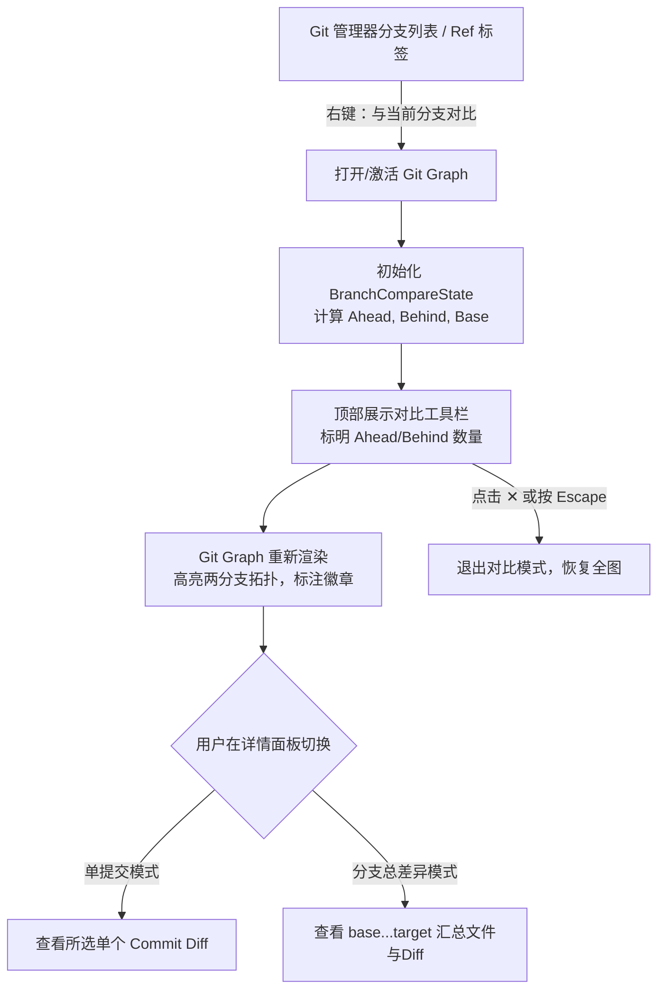

# Git 图形化分支展示与异同对比设计规范 (Git Graph Branch Visualization & Comparison)

**日期:** 2026-10-27  
**状态:** 已完成需求与架构评审，进入实现规划阶段  
**产品定位:** Zed — 体验对齐 Android Studio / IntelliJ IDEA 的 Git 图形化与分支异同管理

---

## 1. 概述与背景 (Overview)

目前 Zed 的 Git Graph（[`crates/git_ui/src/git_graph.rs`](file:///home/noah/Codes/PC/Zed/crates/git_ui/src/git_graph.rs)）已具备基础的多分支提交拓扑和 Canvas 连线绘制能力。但在多分支并行开发、分支分叉和合并复杂的场景下，存在以下不足：
1. **主干与分支泳道不稳定**：`add_commits` 采用简单的“首个空闲泳道”算法分配，当前工作分支（HEAD）常在 Lane 0、Lane 1、Lane 2 之间来回跳跃，没有清晰的主干基准线。
2. **分支去向与来源难以辨识**：无法直观追踪某次提交所属的分支全貌，缺乏类似 Android Studio 的“选中分支/提交后全链路高亮、无关线条半透明置灰”能力。
3. **缺少分支异同对比（Ahead / Behind）**：无法在图形化界面中一目了然看清两条分支之间的差异（例如当前分支独有的提交、目标分支独有的提交、共同祖先分叉点，以及两分支间的文件变更总差异）。

本方案基于**混合高效架构（前端交互 DAG + 内存集合判定 + Git 底层精准 Diff）**，全面优化 Git Graph 的拓扑渲染，并打通分支异同对比功能。

---

## 2. 目标与非目标 (Goals & Non-Goals)

### 2.1 目标 (Goals)
- **主干与泳道布局优化 (Lane Layout & Leftmost HEAD)**：
  - HEAD 分支主干提交链路强制优先占用最左泳道（Lane 0），形成笔直稳定的垂直主干。
  - 分支分叉向右延伸，合并曲线平滑避让，消除泳道跳跃。
  - 分支颜色基于引用（Ref）做确定性分配，保持全局一致。
- **全链路高亮追踪 (Ancestors + Descendants Highlighting)**：
  - 点击或悬停提交/分支标签时，通过内存 DAG 双向遍历快速获取其所有祖先节点与后代衍生节点。
  - Canvas 渲染层对全链路保持高亮饱满绘制，非相关分支圆点与线条自动降透明度（`0.15`~`0.18`）置灰。
- **分支异同对比模式 (Branch Compare Mode: Ahead / Behind)**：
  - 提供醒目的顶部对比状态栏（如 `feature ⮂ main | +3 Ahead, -1 Behind`）。
  - 在提交列表中直观标注 `[Ahead]`（领先独有）、`[Behind]`（落后新提交）、`[Base]`（分叉基点）。
  - 支持仅过滤显示两分支相关拓扑（`filter_to_compared_only`）。
- **两分支总差异与详情面板联动 (Overall Branch Diff)**：
  - 详情面板增加 `[两分支总差异]` 模式，一键汇总两分支间所有变更文件与完整 Diff。
- **全局右键快捷入口与汉化 (Context Menu & Localization)**：
  - Git Manager 分支列表右键新增“与当前分支对比...”快捷入口。
  - 完善所有新增界面的简体中文本地化支持。

### 2.2 非目标 (Non-Goals)
- 不改变底层 `git2` 或 Git CLI 存储协议；
- 不破坏现有 Commit 详情查看、分支检出等基础功能；
- 不引入外部大型依赖，全部基于 GPUI 与现有图形化管线实现。

---

## 3. 架构与详细设计 (Detailed Architecture)

### 3.1 模块职责划分

```
┌─────────────────────────────────────────────────────────────┐
│                       crates/git_ui                         │
│                                                             │
│  ┌───────────────────────┐       ┌───────────────────────┐  │
│  │ git_manager/sections/ │       │      git_graph.rs     │  │
│  │      branches.rs      │       │                       │  │
│  │   右键“与当前分支对比”  │──────>│  BranchCompareState   │  │
│  └───────────────────────┘       │  拓扑优化 & 链路高亮  │  │
│                                  │  Canvas 渲染与置灰    │  │
│                                  └───────────┬───────────┘  │
│                                              │              │
│                                              ▼              │
│                                  ┌───────────────────────┐  │
│                                  │      commit_view      │  │
│                                  │  单提交 Diff / 分支总Diff│  │
│                                  └───────────────────────┘  │
└──────────────────────────────────────────────┬──────────────┘
                                               │
                                               ▼
                                   ┌───────────────────────┐
                                   │    crates/project     │
                                   │       git_store       │
                                   └───────────────────────┘
```

### 3.2 拓扑结构与泳道布局重构 (Lane Layout Optimization)
在 [`crates/git_ui/src/git_graph.rs`](file:///home/noah/Codes/PC/Zed/crates/git_ui/src/git_graph.rs) 的 `GraphData` 中：
1. **主干链优先识别**：
   - 从 `HEAD` 提交开始，递归追踪其 `parents[0]`（第一父提交），预热标记为 `head_trunk_commits: HashSet<Oid>`。
   - 在 `add_commits` 分配泳道时，属于 `head_trunk_commits` 的提交强制固定分配在 `commit_lane = 0`。
2. **派生分支右向展开**：
   - 非主干的第一父提交和合并提交向右分配可用泳道（`Lane 1, 2, ...`）。
3. **确定性分支着色 (Deterministic Colors)**：
   - 为每个分支头 Ref 预分配唯一的色系索引，分支线沿用其源头分支颜色，使得整条分支在长距离滚动中颜色恒定。

### 3.3 内存 DAG 双向索引与全链路高亮 (Lineage Traversal)
1. **数据结构扩展**：
   ```rust
   struct GraphData {
       // ... 现有字段
       children_by_parent: HashMap<Oid, SmallVec<[Oid; 2]>>,
       oid_to_row: HashMap<Oid, usize>,
   }
   ```
2. **全链路计算算法**：
   - 输入目标提交 `target_sha: Oid`；
   - **Ancestors 集合**：从 `target_sha` 开始使用 BFS 沿 `commit.parents` 遍历所有祖先；
   - **Descendants 集合**：从 `target_sha` 开始使用 BFS 沿 `children_by_parent` 遍历所有子代；
   - 结果合并存入 `active_lineage: Option<HashSet<Oid>>`。
3. **Canvas 绘制（置灰与高亮）**：
   - 在 [`GitGraph::render_graph_canvas`](file:///home/noah/Codes/PC/Zed/crates/git_ui/src/git_graph.rs#L3212-L3450) 中：
     - 若 `active_lineage` 不为空：
       - Commit 圆点：若处于集合中，正常鲜艳着色；若不在集合中，`opacity` 设为 `0.18`。
       - Commit 线条：若连接的两端节点均在集合中，以正常线宽饱满绘制；其他线条 `opacity` 降为 `0.15`。
     - 表格文字：非高亮行的文字适度降低对比度，形成强烈的视觉聚焦。

### 3.4 分支异同对比模式 (Branch Compare Mode)
1. **对比状态定义**：
   ```rust
   pub struct BranchCompareState {
       pub base_branch: SharedString,
       pub target_branch: SharedString,
       pub ahead_commits: HashSet<Oid>,
       pub behind_commits: HashSet<Oid>,
       pub merge_base: Option<Oid>,
       pub filter_to_compared_only: bool,
   }
   ```
2. **Ahead / Behind / Base 计算**：
   - 获取 `target_branch` 祖先集合 $A_{target}$ 与 `base_branch` 祖先集合 $A_{base}$；
   - $\text{Ahead} = A_{target} \setminus A_{base}$；
   - $\text{Behind} = A_{base} \setminus A_{target}$；
   - $\text{Base} = \text{Topological-Latest}(A_{target} \cap A_{base})$。
3. **顶部对比条 (Compare Bar)**：
   - 包含分支切换下拉框、Ahead/Behind 数量指示器、过滤开关 `[☑ 仅看差异提交]` 及退出按钮 `[✕]`。
4. **提交项视觉徽章**：
   - `Ahead` 提交：添加绿色 `[Ahead]` 徽章；
   - `Behind` 提交：添加蓝色/红色 `[Behind]` 徽章；
   - `Base` 提交：添加紫色 `[Base 分叉点]` 徽章。
5. **两分支总差异联动**：
   - 详情面板增加分支总差异切换项；
   - 在后台通过 `git diff base...target` 获取两分支之间的文件列表与修改行统计，并复用现有 Diff 视图组件展示。

---

## 4. 关键交互流程 (Interaction Flow)



---

## 5. 编码规范与实现约束 (Coding & Hygiene)
- **Rust 准则**：
  - 严禁使用 `unwrap()`，使用 `?` 严格处理错误；
  - 变量使用完整单词（如 `target_branch`、`highlighted_nodes`，禁止 `tb`、`hn` 等缩写）；
  - 仅在阐述原因（Why）时添加关键注释，不写无意义的代码总结注释；
  - 格式化与 Clippy：遵循 `./script/clippy`，无任何 Warning。
- **GPUI 准则**：
  - 所有 UI 状态变更使用 `cx.notify()` 通知；
  - 异步任务与多线程操作使用 `cx.background_spawn` 并妥善处理生命周期；
  - 测试中计时器必须使用 `cx.background_executor().timer(...)`，禁止使用 `smol::Timer`。

---

## 6. 测试与验证策略 (Testing & Verification)
1. **拓扑与算法测试**：
   - `test_lane_0_head_priority`：多分支交叉拓扑下，断言 HEAD 始终保持在 Lane 0。
   - `test_lineage_traversal`：验证分叉与合并场景下的祖先与后代节点集合计算。
   - `test_branch_compare_ahead_behind`：验证 Ahead/Behind 及 Merge Base 的精准识别。
2. **GPUI 交互测试**：
   - 模拟点击触发高亮与置灰效果；
   - 模拟右键菜单进入对比模式、工具栏切换与退出。
3. **回归测试**：
   - 运行 `cargo test -p git_ui git_graph` 确保既有 20+ 个集成测试全绿。
